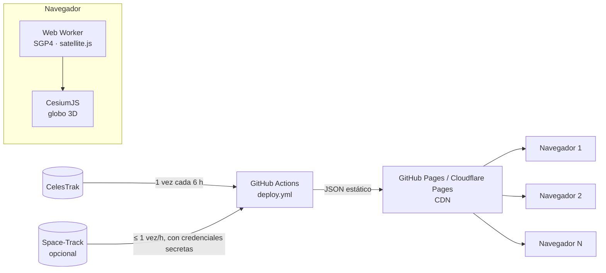

# 🛰️ OrbitWatch

**Visualización y análisis didáctico de objetos y desechos espaciales en órbita.**

Proyecto de código abierto para aprender *Space Domain Awareness* con datos reales: descarga elementos orbitales públicos, calcula dónde está cada objeto con el modelo SGP4, los clasifica y detecta acercamientos peligrosos entre ellos.

> **Estado:** Fase 1 (motor) ✅ y Fase 2 (interfaz web responsive con globo 3D) ✅: 86 pruebas.
> Siguiente: publicar en GitHub Pages con datos reales (M5); ver [Hoja de ruta](#9-hoja-de-ruta-milestones).

```bash
npm install && npm run dev     # abre http://localhost:5173
```

---

## Índice

1. [Glosario: todas las siglas, explicadas](#1-glosario-todas-las-siglas-explicadas)
2. [Verdades incómodas (léase antes de presentar resultados)](#2-verdades-incómodas)
   - [La interfaz web y su diseño responsive](#la-interfaz-web-y-su-diseño-responsive)
3. [Arquitectura y stack tecnológico](#3-arquitectura-y-stack-tecnológico)
4. [Estructura de archivos](#4-estructura-de-archivos)
5. [Instalación y ejecución local](#5-instalación-y-ejecución-local)
6. [Pruebas unitarias](#6-pruebas-unitarias)
7. [Ingesta de datos y límites de las APIs](#7-ingesta-de-datos-y-límites-de-las-apis)
8. [Los algoritmos, con su matemática](#8-los-algoritmos-con-su-matemática)
9. [Hoja de ruta (milestones)](#9-hoja-de-ruta-milestones)
10. [Licencias: qué son y cuál usamos](#10-licencias-qué-son-y-cuál-usamos)
11. [Dónde publicar el código y la aplicación](#11-dónde-publicar-el-código-y-la-aplicación)
12. [¿Alcanza el modelo de IA? Viabilidad y reducción de alcance](#12-alcanza-el-modelo-de-ia-viabilidad-y-reducción-de-alcance)
13. [Cómo dar retroalimentación](#13-cómo-dar-retroalimentación)
14. [Atribuciones](#14-atribuciones)

---

## 1. Glosario: todas las siglas, explicadas

Nadie del equipo necesita saber astrodinámica para empezar. Este glosario es la referencia rápida.

### El dominio

| Sigla | Significado | En palabras simples |
|---|---|---|
| **SDA** | *Space Domain Awareness* | Saber qué hay en el espacio, dónde está, hacia dónde va y qué riesgo representa. Es "el radar de tráfico" del espacio. |
| **SSA** | *Space Situational Awareness* | Nombre anterior (y más civil) de SDA. |
| **RSO** | *Resident Space Object* | Cualquier objeto artificial en órbita: satélites, cohetes, tornillos. |
| **NORAD** | *North American Aerospace Defense Command* | Organización que originalmente asignó los números de catálogo. "NORAD ID" = número único de cada objeto (la ISS es el 25544). |
| **18 SDS** | *18th Space Defense Squadron* (Fuerza Espacial de EE. UU.) | Quien hoy rastrea los objetos con radares y produce los datos públicos. |
| **SATCAT** | *Satellite Catalog* | La base de datos con nombre, dueño, tipo (carga útil, cohete, escombro) y estado de cada objeto. |
| **COSPAR ID** | Designador internacional | Año-número de lanzamiento-pieza: `1998-067A` = 67.º lanzamiento de 1998, pieza A. |
| **R/B, DEB, PAY** | *Rocket Body, Debris, Payload* | Cuerpo de cohete, escombro, carga útil (satélite). |
| **CDM** | *Conjunction Data Message* | Aviso oficial de acercamiento peligroso que reciben los operadores de satélites. |

### Los datos

| Sigla | Significado | En palabras simples |
|---|---|---|
| **GP** | *General Perturbations* | Tipo de datos orbitales "aproximados pero ligeros" que publica el 18 SDS para todo el catálogo. |
| **TLE** | *Two-Line Element set* | Formato de 1960s: 2 líneas × 69 caracteres con los elementos orbitales. **3LE** = TLE + línea con el nombre. |
| **OMM** | *Orbit Mean-Elements Message* | El mismo contenido que un TLE, en formato moderno con nombres de campo (JSON, CSV, XML). Estándar internacional. |
| **CCSDS** | *Consultative Committee for Space Data Systems* | Comité de agencias espaciales (NASA, ESA, JAXA…) que define estándares como OMM. |
| **Alpha-5** | — | Parche que mete números ≥100 000 en 5 caracteres usando una letra (A0000 = 100000). Llega hasta 339 999. |
| **B\*** ("B-star") | Término de arrastre | Qué tanto frena la atmósfera al objeto. Más grande = cae más rápido. |
| **Época** | — | El instante para el cual los elementos son válidos. Lejos de la época, la precisión se degrada. |

### La física y la matemática

| Sigla | Significado | En palabras simples |
|---|---|---|
| **SGP4 / SDP4** | *Simplified General Perturbations 4 / Simplified Deep-space Perturbations 4* | El modelo que calcula la posición a partir de un TLE/OMM. SDP4 es su variante para órbitas lejanas (período > 225 min). |
| **ECI** | *Earth-Centered Inertial* | Ejes con origen en el centro de la Tierra que **no** giran con ella (apuntan a estrellas fijas). |
| **TEME** | *True Equator, Mean Equinox* | El ECI particular que produce SGP4. Ojo: **no** es igual a J2000 (ver §2). |
| **J2000 / GCRF** | Marcos inerciales "estándar" | Los que usan NASA/ESA para casi todo lo demás. |
| **ECEF** | *Earth-Centered, Earth-Fixed* | Ejes que giran con la Tierra. Lo que necesita un globo 3D. |
| **GMST** | *Greenwich Mean Sidereal Time* | Ángulo de rotación de la Tierra en un instante. Convierte ECI ↔ ECEF. |
| **WGS-72 / WGS-84** | *World Geodetic System* | Modelos matemáticos del tamaño y forma de la Tierra. SGP4 usa WGS-72. |
| **J2** | Segundo armónico zonal | Efecto del "abultamiento" ecuatorial de la Tierra: hace girar lentamente los planos orbitales. |
| **RAAN** | *Right Ascension of the Ascending Node* | Hacia qué dirección del espacio cruza la órbita el ecuador de sur a norte. |
| **LEO / MEO / GEO / HEO** | *Low / Medium / Geosynchronous / Highly Elliptical Earth Orbit* | Regímenes: bajo (< 2 000 km, la ISS), medio (GPS, ~20 200 km), geosíncrono (~35 786 km, gira con la Tierra), altamente elíptico. |
| **GTO** | *Geostationary Transfer Orbit* | Órbita elíptica de paso hacia GEO; muchos cuerpos de cohete se quedan ahí. |
| **TCA** | *Time of Closest Approach* | Instante de máximo acercamiento entre dos objetos. |
| **RIC** | *Radial, In-track, Cross-track* | Ejes "desde el punto de vista" de un satélite: hacia arriba, hacia adelante, hacia el costado. |
| **Pc** | *Probability of Collision* | Probabilidad de choque. Requiere incertidumbres (covarianza) que los datos públicos no traen. |

### El software

| Sigla | Significado | En palabras simples |
|---|---|---|
| **API** | *Application Programming Interface* | Una "ventanilla" por donde un programa pide datos a otro. |
| **M2M** | *Machine-to-Machine* | Programas que se hablan sin humano de por medio (y por eso pueden saturar un servidor sin que nadie se dé cuenta). |
| **Rate limit** | Límite de tasa | Máximo de peticiones por minuto/hora que acepta una API. |
| **TTL** | *Time To Live* | Cuánto tiempo se considera vigente un dato guardado en caché. |
| **CI/CD** | *Continuous Integration / Continuous Deployment* | Robots (GitHub Actions) que prueban y publican el código automáticamente en cada cambio. |
| **CDN** | *Content Delivery Network* | Red de servidores que entrega archivos estáticos rápido desde el lugar más cercano al usuario. |
| **JSDoc** | — | Comentarios `/** … */` con formato estándar que documentan funciones y que los editores muestran al pasar el cursor. |
| **WASM** | *WebAssembly* | Código compilado que corre en el navegador casi a velocidad nativa. |

---

## 2. Verdades incómodas

Un proyecto de SDA que exagera su precisión es peor que no tener proyecto. Estas son las limitaciones reales; el equipo de marketing debe conocerlas antes de escribir un solo *copy*.

1. **Los TLE/OMM tienen errores de ~1 km en la época** (LEO), que crecen del orden de 1–3 km por día. Son para visualizar y cribar, no para maniobrar.
2. **El cribado de conjunciones NO es evaluación de riesgo.** Calculamos la distancia mínima, no la probabilidad de colisión (Pc). Un "acercamiento de 300 m" calculado con TLE no significa "van a chocar". Nunca publiques algo como "alerta de colisión" basado en esta herramienta.
3. **TEME ≠ "ECI" genérico.** SGP4 entrega posiciones en TEME. Compararlas directamente con datos J2000 de otra fuente produce diferencias de hasta kilómetros que no son errores del código.
4. **El catálogo cruzó los 5 dígitos el 2026-07-11** (objeto 100000, SARAMAGO). El límite real del TLE clásico era 69 999, no 99 999. Todo objeto nuevo necesita OMM. Por eso este proyecto usa OMM como formato principal.
5. **El catálogo público no es todo lo que hay.** Faltan objetos clasificados y fragmentos menores a ~10 cm que no se rastrean de forma rutinaria.
6. **Los datos envejecen.** Un TLE de hace un mes ubica mal a un objeto en LEO. Por eso el repositorio no trae "TLEs actuales" fijos (serían falsos en semanas): trae un script que los descarga.
7. **CelesTrak es gratuito porque lo sostiene una persona** (Dr. T.S. Kelso) y su comunidad. Abusar de su API puede bloquear tu IP… o a toda la red de tu universidad.

### La interfaz web y su diseño responsive


**Qué puedes hacer:**

| Zona | Función |
|---|---|
| **Barra superior** | Búsqueda por NORAD, nombre o COSPAR (atajo <kbd>/</kbd>, flechas y <kbd>Enter</kbd>), tema claro/oscuro, glosario. |
| **Panel de datos y filtros** | Fuente de datos y su antigüedad, cargar archivo (o arrastrarlo al globo), agregar población sintética, filtros por tipo y régimen con conteos. |
| **Globo** | Puntos coloreados por tipo, día/noche según el Sol del tiempo simulado, órbita del objeto elegido, vistas LEO/MEO/GEO. |
| **Barra de tiempo** | Pausa (<kbd>Espacio</kbd>), velocidad (−1 h/s a +1 h/s), saltar a fecha UTC, volver a "Ahora". |
| **Inspector** | Posición en vivo, período, inclinación, apogeo, perigeo y avisos honestos (dato sintético, elementos viejos, objeto que ya reentró). |
| **Acercamientos** | Cribado en un Web Worker con progreso y botón de cancelar. Al tocar un resultado se viaja a su TCA. |

Cada término técnico tiene un botón **?** que abre el glosario justo en esa entrada.

**Diseño responsive: una sola página, tres disposiciones.** Se decide en CSS con *media queries* (reglas que se aplican según el ancho de la pantalla), sin duplicar HTML:

| Ancho | Disposición | Por qué |
|---|---|---|
| ≥ 1100 px (escritorio) | 3 columnas fijas: filtros · globo · inspector (*CSS Grid*) | Hay espacio para ver todo a la vez. |
| 720–1099 px (tableta) | Globo a pantalla completa; los paneles son **cajones laterales** que se abren con botones | El globo es lo importante; los paneles se consultan a ratos. |
| < 720 px (celular) | Paneles como **hojas inferiores** (al estilo de Google Maps); búsqueda en una segunda fila; la barra de tiempo ocupa todo el ancho | El pulgar alcanza la parte de abajo; el globo queda visible arriba. |

Detalles que se probaron con un navegador real a 1440×900, 820×1180 y 390×844: no hay desplazamiento horizontal; el área para tocar puntos es de 16 px (los puntos miden 4); se respetan las zonas seguras del iPhone (`env(safe-area-inset-*)`); hay foco visible para teclado, roles ARIA en la búsqueda, y se reducen las animaciones si el sistema lo pide (`prefers-reduced-motion`).

**Modo demostración (sin internet).** Si no existe `data/catalog.json`, la app carga 3 TLE históricos reales (ISS 2008, Vanguard 1, CBERS 2) y 3 000 objetos **sintéticos** generados con un algoritmo determinista que imita la distribución del catálogo: una constelación a 550 km, órbitas heliosíncronas, nubes de escombros, navegación MEO, el anillo GEO y órbitas de transferencia GTO. Se etiquetan "SYNTH", con NORAD ≥ 900 000 y una insignia **SINTÉTICO**: nunca se presentan como reales. El reloj arranca en la época de esos datos (2008), porque propagarlos a hoy daría posiciones sin sentido.

---

## 3. Arquitectura y stack tecnológico

### Principio rector: "1 descarga, N usuarios"

El error de diseño más común en este tipo de apps es que **cada navegador** pida datos a CelesTrak. Con 1 000 visitantes son 1 000 peticiones por ciclo, y CelesTrak bloquea por IP. Nuestra arquitectura separa ingesta y consumo:



**Economía del diseño:** el costo hacia CelesTrak pasa de ser *variable* (proporcional a visitantes × recargas) a ser *fijo* (29 peticiones por ciclo). El costo marginal de un visitante adicional para CelesTrak es cero; lo absorbe la CDN gratuita.

### Stack recomendado

| Capa | Elección | Por qué | Alternativas descartadas |
|---|---|---|---|
| Lenguaje | **TypeScript** (modo estricto) | Un solo lenguaje para motor y web; los tipos atrapan errores de unidades y campos nulos antes de ejecutar. | Python: excelente para análisis, pero obliga a dos lenguajes (backend + JS para el globo). |
| Propagación | **satellite.js 7** (MIT) | Implementación de SGP4 en JS validada contra los casos oficiales (ver §6); soporta OMM (`json2satrec`) y trae un módulo WASM para propagación masiva. | Implementar SGP4 a mano: ~1 500 líneas de Fortran traducido; riesgo enorme, beneficio nulo. |
| Globo 3D | **CesiumJS** (Apache-2.0) | Globo geoespacial real, manejo nativo de tiempo, ECEF y miles de puntos con `PointPrimitiveCollection`. Puede usar imágenes de Tierra incluidas (Natural Earth II) sin token. | Three.js: más control artístico, pero hay que construir el globo, la rotación terrestre y las coordenadas a mano. WorldWind Kotlin: orientado a Android/JVM, no encaja con un equipo web. |
| Empaquetado | **Vite** | Servidor de desarrollo instantáneo; genera un sitio estático listo para Pages. | Webpack: más configuración. |
| Pruebas | **Vitest** | Rápido, nativo de TypeScript/ESM. | Jest: requiere más configuración con ESM. |
| CI/CD y datos | **GitHub Actions** | Gratis para repos públicos; ejecuta pruebas y la ingesta programada. | Un servidor propio: costo y mantenimiento innecesarios. |
| Hosting | **GitHub Pages** (o Cloudflare Pages) | Sitio estático gratuito con HTTPS. | Ver §11. |

### Rendimiento: números medidos, no supuestos

Medido en el entorno de desarrollo de este proyecto (Node 22):

| Operación | Costo |
|---|---|
| 1 llamada SGP4 (órbita baja) | ~1.5 µs |
| 1 llamada SDP4 (GEO, MEO, GTO: incluye Sol y Luna) | ~10–20 µs, y crece al alejarse de la época |
| Un "cuadro" de la demo (3 003 objetos, 16 % de espacio profundo) | ~15 ms en Node; 5–100 ms en navegador según el equipo |
| Cribar 1 par de objetos durante 24 h (paso 60 s) | ~17 ms |
| Cribar 1 objeto LEO contra 3 002 candidatos (1 152 pasan el filtro), 24 h | ~4 s en el navegador (Web Worker, cancelable) |
| Cribar **todos contra todos** (~4.5×10⁸ pares) | Inviable en un navegador. Para eso existe [SOCRATES Plus](https://celestrak.org/SOCRATES/) de CelesTrak. |

---

## 4. Estructura de archivos

```text
orbitwatch/
├── src/
│   ├── index.ts                 # API pública del motor (lo único que importará la web)
│   ├── core/                    # Lógica pura: sin red, sin disco, 100 % probada
│   │   ├── constants.ts         # μ, radio terrestre (WGS-72), umbrales de régimen
│   │   ├── types.ts             # ElementSet, StateVector, categorías…
│   │   ├── tle.ts               # Parser TLE: checksum, Alpha-5, decimales implícitos
│   │   ├── omm.ts               # Parser OMM JSON/CSV, cruce con SATCAT
│   │   ├── propagator.ts        # SGP4 vía satellite.js; TEME → ECEF → lat/lon/alt
│   │   ├── elements.ts          # Kepler: período, apogeo, perigeo, régimen
│   │   ├── catalog.ts           # Clasificación por color, búsqueda, filtros
│   │   └── conjunction.ts       # Cribado de acercamientos (TCA, distancia, RIC)
│   └── ingest/                  # Todo lo que toca la red, aislado y "bien portado"
│       ├── rateLimiter.ts       # Ventana deslizante (Space-Track: 25/min, 250/h)
│       ├── cache.ts             # Caché con TTL (interfaz + memoria)
│       ├── fileCache.ts         # Caché en disco para scripts de Node
│       ├── celestrak.ts         # Cliente con TTL ≥ 2 h y circuit breaker
│       └── spacetrack.ts        # Cliente con sesión, limitador y caché de 1 h
├── web/                         # La interfaz (Vite + CesiumJS)
│   ├── index.html               # Estructura: barra superior, 2 paneles, globo, barra de tiempo
│   ├── public/                  # Archivos servidos tal cual
│   │   ├── cesium/              # (generado) copia de CesiumJS — no se sube a git
│   │   └── data/catalog.json    # (generado) catálogo real — no se sube a git
│   └── src/
│       ├── main.ts              # Controlador: conecta datos, workers, globo y paneles
│       ├── styles.css           # Diseño responsive (3 disposiciones) y temas claro/oscuro
│       ├── globe.ts             # Envoltura de CesiumJS: puntos, órbita, selección, cámara
│       ├── cesium.ts            # Tipos de Cesium sin empaquetarlo
│       ├── clock.ts             # Reloj de simulación (tasa, pausa, inicio inteligente)
│       ├── glossary.ts          # Textos de los botones "?"
│       ├── data/detect.ts       # Detecta TLE / OMM JSON / OMM CSV / catálogo
│       ├── data/demo.ts         # TLE históricos + población SINTÉTICA etiquetada
│       ├── ui/format.ts         # Números, fechas y coordenadas en español
│       └── workers/             # Hilos de cálculo: propagación y conjunciones
├── scripts/
│   ├── demo.ts                  # Demostración del motor en la terminal
│   ├── fetch-sample.ts          # Descarga datos reales (29 peticiones, con caché)
│   ├── build-catalog.ts         # Une lo descargado en web/public/data/catalog.json
│   └── copy-cesium.ts           # Copia CesiumJS a web/public/cesium
├── tests/                       # Suite Vitest (86 pruebas)
├── data/
│   ├── validation/sgp4-verification.tle   # Casos oficiales de Vallado (2006)
│   ├── historical/iss-2008.tle            # TLE didáctico clásico de la ISS
│   └── relevant-objects.json              # Lista curada (IDs) para validar la app
├── .github/workflows/
│   ├── ci.yml                   # Pruebas automáticas en cada cambio
│   └── deploy.yml               # Cada 6 h: datos frescos → build → GitHub Pages
└── LICENSE  NOTICE  .env.example  package.json  tsconfig.json  vite.config.ts
```

**Estrategia de cuadros en la web:** el worker calcula un cuadro y el hilo principal pide el siguiente sólo cuando recibió el anterior. Con pocos objetos se logran ~60 cuadros/s; con muchos, menos, pero la interfaz nunca se congela. No interpolamos: a 10 min/s, interpolar linealmente entre cuadros de 1 s cortaría la órbita con errores de cientos de km.

**Regla de dependencias:** `core/` no importa nada de `ingest/` ni de la web. Así el motor se prueba sin internet y se puede reutilizar (en un Worker, en un script, en un notebook).

---

## 5. Instalación y ejecución local

### Requisitos

- **Node.js 20 o superior** (recomendado 22 LTS). Node es el programa que ejecuta JavaScript/TypeScript fuera del navegador. Descárgalo de <https://nodejs.org> (opción "LTS"). Comprueba con `node --version`.
- **Git** para clonar el repositorio: <https://git-scm.com>.
- Un editor; recomendado **VS Code**, que entiende TypeScript y muestra la documentación JSDoc al pasar el cursor.

### Pasos

```bash
git clone https://github.com/<tu-organizacion>/orbitwatch.git
cd orbitwatch
npm install          # OBLIGATORIO la primera vez: descarga las dependencias (~150 MB)
npm run check        # chequeo de tipos + pruebas (debe decir 86 passed)
npm run dev          # la interfaz en http://localhost:5173 (modo demostración)
```

**Con datos reales** (requiere internet; respeta la política de CelesTrak):

```bash
npm run fetch:sample   # 29 peticiones (~40 s); repetirlo antes de 2 h usa la caché
npm run build:catalog  # genera web/public/data/catalog.json
npm run dev            # ahora la app muestra el cielo de hoy
```

**Versión de producción:** `npm run build` genera `dist/` (sitio estático, ~24 MB por CesiumJS) y `npm run preview` lo sirve para revisarlo.

| Comando | Qué hace |
|---|---|
| `npm run dev` | Servidor de desarrollo con recarga instantánea |
| `npm run build` / `preview` | Sitio de producción en `dist/` / revisarlo localmente |
| `npm run check` | Tipos + 86 pruebas |
| `npm run demo` | Demostración del motor en la terminal |
| `npm run fetch:sample` / `build:catalog` | Datos reales → catálogo de la web |

Salida esperada de `npm run demo` (fragmento):

```text
2) INSPECTOR DE METADATOS (en la época de cada TLE)
   NORAD  Nombre            Régimen  Período(min) Incl(°)  Perigeo(km) Apogeo(km)
       5  VANGUARD 1        MEO         133.1      34.27      651.3     3863.1
   25544  ISS (ZARYA)       LEO          91.6      51.64      348.8      357.8

4) CRIBADO DE CONJUNCIONES — par SINTÉTICO que cruza nodos
   TCA 2026-10-31T00:00:01.735Z  fallo      3.747 km  v_rel       5.97 km/s
```

### Solución de problemas

| Síntoma | Causa | Solución |
|---|---|---|
| `tsx: command not found` o `vite: command not found` | No se instalaron las dependencias (el zip y el repositorio **no** incluyen `node_modules/`) | `npm install` una vez, dentro de la carpeta `orbitwatch` |
| La página se ve como texto plano, sin colores ni globo | Abriste `web/index.html` con doble clic. El navegador no ejecuta TypeScript ni carga los estilos así | `npm run dev` y abre **http://localhost:5173** |
| `Tu Node.js es 18.x…` | Vite 8 necesita Node 20.19+ o 22.12+ | Fedora: `sudo dnf install nodejs22`; o [nvm](https://github.com/nvm-sh/nvm) |
| `⛔ CelesTrak respondió con error` | La red bloqueó a CelesTrak o se pidió de más | Espera 2 h y revisa la causa; mientras, `npm run dev` funciona en modo demostración |
| Globo negro, sin Tierra | WebGL desactivado en el navegador | Prueba otro navegador o activa la aceleración por hardware |

Antes de cada comando corre una verificación (`scripts/check-setup.mjs`) que detecta los dos primeros casos y dice en español qué hacer.

### Usar el motor en tu propio código

```ts
import { parseOmmJson, Propagator, deriveOrbitMetrics, temeToGeodetic } from './src/index';

const { records } = parseOmmJson(jsonDescargado);           // OMM → ElementSet[]
const prop = Propagator.fromElementSet(records[0]!);         // inicializa SGP4 una vez
const res = prop.propagate(new Date());                      // posición ahora (TEME)
if (res.ok) console.log(temeToGeodetic(res.state.positionTeme, new Date()));
else console.warn(res.message);                              // p. ej. "El objeto ya reentró…"
console.log(deriveOrbitMetrics(records[0]!, prop.satrec));   // período, apogeo, perigeo, régimen
```

---

## 6. Pruebas unitarias

```bash
npm test            # una vez
npm run test:watch  # se re-ejecuta al guardar
```

| Archivo | Qué garantiza |
|---|---|
| `tle.test.ts` | Checksum, Alpha-5 (biyección en todo su rango, rechazo de I/O y de > 339 999), decimales implícitos, pivote del año 57, extracción de cada campo de la ISS, rechazo de TLE corruptos sin abortar el lote. |
| `omm.test.ts` | CSV RFC 4180, números de 6+ dígitos, valores como texto (Space-Track), **equivalencia TLE ↔ OMM** (< 10 m a ±1 día), cruce con SATCAT. |
| `propagator.test.ts` | **SGP4 contra los vectores oficiales de Vallado et al. (2006) con tolerancia de 1 mm**, conversiones TEME→ECEF (rotación: conserva norma y eje z), un GEO "quieto" en longitud, decaimiento reportado como error. |
| `elements-catalog.test.ts` | Kepler (a_GEO ≈ 42 164 km), identidad apogeo − perigeo = 2ae, regímenes (ISS, GPS, GEO, Molniya, GTO), clasificación por color, búsqueda y filtros. |
| `conjunction.test.ts` | Filtro apogeo/perigeo, marco RIC, **TCA igual al de una búsqueda exhaustiva a 10 ms**, cero falsos negativos frente a un muestreo de 5 s, ordenamiento. |
| `web.test.ts` | Formatos en español (m/km, "hace 3 h", 99.13° O), reloj de simulación (continuidad al cambiar velocidad, reversa), detección de TLE/OMM/CSV/catálogo, población sintética determinista que cubre los 4 regímenes y siempre propaga, glosario completo. |
| `ingest.test.ts` | Limitador (nunca > 25/min ni > 250/h), una sola descarga por ciclo de 2 h, TTL mínimo forzado, manejo del 403 "sin cambios", parada total ante 404/301, sesión de Space-Track. Todo con reloj y red simulados: **las pruebas nunca tocan internet**. |

**¿Por qué los vectores de Vallado?** Son la "respuesta oficial" publicada junto con la revisión de SGP4 de 2006. Si nuestro motor reproduce esos números al milímetro, sabemos que la propagación es correcta. Las épocas son de 2000 y 2006, así que sirven para probar, no para ver el cielo de hoy.

**Política de datos de prueba:** cuando una prueba necesita una geometría con respuesta conocida (p. ej. dos órbitas que se cruzan), usamos objetos **sintéticos** con NORAD 900 000+ y nombre "SYNTH". Nunca inventamos datos y los hacemos pasar por reales.

---

## 7. Ingesta de datos y límites de las APIs

### Comparación de fuentes

| | CelesTrak | Space-Track.org |
|---|---|---|
| Cuenta | No requiere | Gratis, con registro y acuerdo de usuario |
| Actualización | Cada 2 h (el 18 SDS publica 2–3 veces al día) | Continua |
| Límite | 1 descarga por recurso por ciclo de 2 h (aplicado con HTTP 403 en `active` y `starlink`); ~50 errores HTTP en 2 h → firewall; > ~100 MB/día puede bloquear | < 30 peticiones/min y < 300/h; catálogo completo (`class/gp`) máx. 1 vez/h |
| Ante errores | El software M2M debe **detenerse y avisar a un humano** ante cualquier código ≠ 200 | Suspensión temporal de la cuenta |
| Formato por defecto | CSV desde 2026-05-09 (**siempre** especificar `FORMAT`) | Según la consulta |
| Redistribución pública | Pensado para difusión pública | Revisar el acuerdo de usuario antes de republicar |
| Uso en este proyecto | **Fuente principal** | Opcional, sólo desde CI con *secrets* |

### Cómo nos mantenemos bajo los límites (implementado y probado)

1. **Caché con TTL mínimo forzado** (`celestrak.ts`): aunque alguien configure 10 minutos, el cliente usa 2 h. Pedir 50 veces seguidas = 1 petición real.
2. **Circuit breaker**: cualquier 301/404/5xx abre el interruptor y **no se vuelve a llamar** hasta que un humano lo revise (`resetCircuit()`). El 403 "*has not updated*" es benigno: se sirve la caché previa y se espera al siguiente ciclo.
3. **Sin redirecciones automáticas** (`redirect: 'manual'`) y dominio `celestrak.org` fijo: un 301 indica una URL mal escrita y se trata como error, no se repite en silencio.
4. **Una consulta por objeto, en serie y con pausa de 1 s**: `CATNR` acepta UN solo número; una lista con comas responde `Invalid query` (lo descubrimos en la primera corrida real). Para muchos objetos se usan grupos (`GROUP=active`), que traen miles en una sola petición.
5. **Validación del contenido, no sólo del código HTTP**: CelesTrak responde errores de consulta y "sin datos" con código 200 y texto plano. El cliente exige un arreglo JSON antes de guardar en caché (`InvalidResponseError`); si no, avisa, omite ese objeto y, tras 3 fallos seguidos, se detiene.
6. **Limitador de ventana deslizante doble** para Space-Track (25/min y 250/h, ≈83 % del máximo).
7. **Arquitectura "1 descarga, N usuarios"** (§3): el navegador nunca llama a las APIs.
8. **Credenciales sólo en el servidor**: `SPACETRACK_IDENTITY` / `SPACETRACK_PASSWORD` en `.env` local (ignorado por git) o en *GitHub Secrets*. Jamás en el código del navegador, que cualquiera puede leer.

### ¿Cómo sabemos si algo es basura o satélite?

El JSON de elementos de CelesTrak **no** trae el tipo de objeto. Se obtiene cruzando por NORAD ID con el **SATCAT** (`mergeSatcat`), que da `OBJECT_TYPE` (PAY/R/B/DEB/UNK) y `OPS_STATUS_CODE` (`+` operativo, `-` muerto…). Sin SATCAT, se infiere por nombre ("… DEB", "… R/B") y, si no hay pista, se marca **desconocido**: nunca se asume "satélite".

Colores (`CATEGORY_COLORS`, elegidos para ser distinguibles con daltonismo): azul = carga útil activa · gris = carga útil inactiva · ámbar = cuerpo de cohete · rojo = escombro · violeta = desconocido.

---

## 8. Los algoritmos, con su matemática

### 8.1 Del TLE a la órbita: Kepler

El TLE da el movimiento medio *n* (vueltas/día). La **Tercera Ley de Kepler** relaciona período y tamaño:

$$a = \sqrt[3]{\frac{\mu}{n^2}}, \qquad r_{apogeo} = a(1+e), \qquad r_{perigeo} = a(1-e), \qquad T = \frac{2\pi}{n}$$

con μ = 398 600.8 km³/s² (WGS-72) y *n* en rad/s. Las altitudes restan el radio terrestre (6 378.135 km). Ejemplo: con *n* = 1.0027 rev/día, *a* ≈ 42 164 km → órbita geoestacionaria.

*Matiz:* el *n* del TLE es un promedio "de Kozai" y SGP4 lo convierte a "de Brouwer". Por eso el inspector usa los valores internos de SGP4 (consistentes con la propagación) y la fórmula pura queda para filtros rápidos.

### 8.2 Propagación

`Propagator` inicializa SGP4 **una vez** por objeto (lo costoso) y luego evalúa posiciones en microsegundos. Si el objeto reentró o los elementos son degenerados, devuelve `{ ok: false, message }` en vez de coordenadas basura. Luego: TEME → (rotación por GMST) → ECEF → latitud/longitud/altitud.

### 8.3 Cribado de conjunciones

Buscamos los mínimos de la distancia *d(t)* = |**r**₂(t) − **r**₁(t)|. En un mínimo, la derivada de *d²* es cero y cambia de signo de − a +:

$$\frac{d}{dt}\,d^2 = 2\,\Delta\mathbf{r}\cdot\Delta\mathbf{v} = 0$$

Esto convierte un problema de **optimización** en uno de **búsqueda de raíces**, mucho más robusto:

1. **Filtro apogeo/perigeo** (Hoots, 1984): si el perigeo del objeto alto supera el apogeo del bajo más un margen, nunca se tocan. O(1) por par, descarta la mayoría sin propagar.
2. **Muestreo** de *f(t)* = Δ**r**·Δ**v** cada 60 s; un cambio de signo − → + garantiza (Teorema del Valor Intermedio) un mínimo en ese intervalo.
3. **Refinamiento** con el método de Illinois (regula falsi modificada) hasta 1 ms: converge rápido y nunca sale del intervalo.
4. **Salida**: TCA, distancia, rapidez relativa y descomposición **RIC**. Si el mínimo cae en el borde de la ventana se marca `atWindowEdge`.

**Validación:** la prueba compara contra una búsqueda exhaustiva independiente; el TCA coincide a < 20 ms y la distancia a < 1 m. Además, la rapidez relativa calculada (5.97 km/s) coincide con la fórmula geométrica 2·v·sin(Δi/2) para dos órbitas circulares que se cruzan.

**Complejidad:** O(P · K) propagaciones, con P = pares que pasan el filtro y K = duración/paso. Un día a 60 s son 1 440 muestras por par (+ ~10 por refinamiento).

---

## 9. Hoja de ruta (milestones)

Cada milestone termina en algo **demostrable**. Los roles sugeridos aprovechan la mezcla del equipo.

| # | Milestone | Entregable verificable | Ingeniería de software | IA | Marketing digital |
|---|---|---|---|---|---|
| **M0** | Arranque | Repo público, CI en verde, todos corren `npm run check` | Configurar repo, ramas, protección de `main` | Revisar el glosario; preparar preguntas para la IA | Nombre, logotipo, tono; redactar la sección "verdades incómodas" en lenguaje público |
| **M1** ✅ | Motor de cálculo | Esta Fase 1: 67 pruebas, demo offline | Hecho | Hecho | — |
| **M2** | Datos reales | `deploy.yml` corriendo; catálogo real en la web | Activar Actions, monitorear el circuit breaker | Auditar calidad de datos (edad de elementos, objetos sin tipo) | Página "Fuentes y créditos" |
| **M3** ✅ | Interfaz responsive | Globo, filtros, búsqueda, inspector, tiempo, conjunciones en Worker, glosario | Hecho | Hecho | **Pendiente:** prueba con 5 usuarios reales en celular y escritorio |
| **M4** | Catálogo completo | Todo el catálogo (~30 000 objetos con R/B y escombros) vía Space-Track `class/gp` desde CI | Medir cuadros/s con 30 000 puntos; considerar el módulo WASM de satellite.js | Cribado precalculado en CI para objetos de interés | Capturas y textos de la página |
| **M5** | Producción | Sitio público en GitHub Pages con datos que se actualizan solos (`deploy.yml` ya incluido) | Activar Pages, revisar el primer despliegue, dominio | Monitoreo de anomalías (objetos "perdidos", saltos de órbita) | Lanzamiento: post, video corto, README con capturas |
| **M6** | Extensiones (opcional) | Órbitas dibujadas, línea de tiempo, comparación de eventos de fragmentación | — | Clasificar maniobras a partir del historial de elementos | Métricas de uso (respetando privacidad) |

---

## 10. Licencias: qué son y cuál usamos

**¿Qué es una licencia de software?** Por ley, todo código tiene derechos de autor desde que se escribe. Si publicas código **sin** licencia, legalmente nadie puede usarlo, copiarlo ni modificarlo, aunque esté público en GitHub. Una licencia de código abierto es el permiso por escrito que dice qué se puede hacer y bajo qué condiciones.

| Licencia | Tipo | Qué exige | Cuándo conviene |
|---|---|---|---|
| **MIT** | Permisiva | Conservar el aviso de copyright | Máxima simplicidad y adopción |
| **Apache-2.0** ⭐ | Permisiva | Conservar avisos y `NOTICE`; indicar cambios. **Incluye concesión explícita de patentes** | Proyectos que quieren adopción amplia y protección legal más clara |
| **GPL-3.0** | *Copyleft* | Quien distribuya versiones modificadas debe liberar su código con la misma licencia | Garantizar que las mejoras sigan siendo libres |
| **AGPL-3.0** | *Copyleft* de red | Igual que GPL, también si sólo se ofrece como servicio web | Evitar que alguien lo convierta en servicio cerrado |
| **CC BY 4.0** | Para contenido (no código) | Atribución | Documentación, imágenes, material didáctico |

**Recomendación:** **Apache-2.0** para el código (ya incluida en `LICENSE`) y **CC BY 4.0** para la documentación y el material didáctico. Apache-2.0 es compatible con nuestras dependencias (satellite.js es MIT; CesiumJS es Apache-2.0) y su cláusula de patentes protege a estudiantes y usuarios.

**Los datos tienen sus propias reglas:** el código es nuestro, los datos orbitales no. Por eso el repositorio no redistribuye datos de Space-Track y siempre acredita a CelesTrak y al 18 SDS.

---

## 11. Dónde publicar el código y la aplicación

### El código (repositorio)

Un **repositorio** es la carpeta del proyecto con todo su historial de cambios (gestionado con **git**). Una **forja** es el sitio web que lo aloja y añade colaboración: *issues* (lista de tareas y errores), *pull requests* (propuestas de cambio revisadas por otros) y automatización.

| Forja | Ventajas | Desventajas |
|---|---|---|
| **GitHub** ⭐ | Mayor comunidad; Actions gratis en repos públicos; Pages integrado; visibilidad para portafolios | Propiedad de Microsoft |
| GitLab | CI muy completa; se puede autoalojar | Menos comunidad en proyectos educativos |
| Codeberg | Sin fines de lucro, enfocada en software libre | CI y hosting más limitados |

**Primeros pasos en GitHub:** crear cuenta → crear una **Organization** para el equipo (así el proyecto no depende de una persona) → crear el repositorio `orbitwatch` público → subir este código → en *Settings → Branches* proteger `main` para que todo cambio pase por un *pull request* con CI en verde.

### La aplicación en vivo (hosting estático)

Nuestra app es **estática** (HTML, JS y JSON; sin servidor propio), así que el hosting es gratuito:

| Servicio | Plan gratuito (verificado oct-2026; revisa antes de decidir) | Comentario |
|---|---|---|
| **GitHub Pages** ⭐ | Sitio ≤ 1 GB, ~100 GB/mes de ancho de banda (límite blando); no permitido para negocios/SaaS comerciales | Lo más simple: vive junto al código y se despliega con el mismo Actions |
| **Cloudflare Pages** | Ancho de banda sin medición, 500 builds/mes, ≤ 20 000 archivos, ≤ 25 MiB por archivo | Mejor si el tráfico crece. Cloudflare recomienda Workers para proyectos nuevos; para un sitio estático Pages sigue siendo válido |
| Netlify / Vercel | Planes gratuitos con límites de ancho de banda y minutos de build | Buenos, pero añaden otra cuenta y otra plataforma |
| surge.sh | Despliegue por línea de comandos | Útil para pruebas rápidas; menos integración con CI |

**Publicar en GitHub Pages paso a paso** (el workflow `deploy.yml` ya está listo):

1. Suban el repositorio a GitHub (rama `main`).
2. En el repositorio: **Settings → Pages → Build and deployment → Source: GitHub Actions**.
3. Vayan a la pestaña **Actions**, elijan **Deploy** y pulsen **Run workflow** (o hagan cualquier *push* a `main`).
4. En ~3 minutos el sitio estará en `https://<organizacion>.github.io/orbitwatch/`. Se volverá a publicar solo cada 6 horas con datos frescos.
5. Si un día CelesTrak responde con error, el job se detiene **sin publicar** y el sitio conserva la última versión buena. La ✗ roja en Actions avisa que hay que revisar.

**Recomendación:** empezar con **GitHub Pages** (M5). Si el tráfico supera los límites, mover el mismo sitio a Cloudflare Pages sin cambiar código. La URL quedará como `https://<organizacion>.github.io/orbitwatch/`.

---

## 12. ¿Alcanza el modelo de IA? Viabilidad y reducción de alcance

Esta Fase 1 se produjo y validó con Claude Opus 5.5. Evaluación honesta para el resto:

- **El proyecto completo es viable con el modelo actual**, *si se trabaja por milestones*. Ningún módulo es más complejo que lo ya hecho; lo difícil del SGP4 lo resuelve una biblioteca validada.
- **El cuello de botella no es la inteligencia del modelo, sino el contexto**: pedir "toda la app en una respuesta" produce código superficial. Pidan un milestone por conversación y peguen sólo los archivos relevantes.
- **Con un modelo menos potente**, reduzcan alcance así (cada nivel sigue siendo un proyecto presentable):
  1. **Nivel A (mínimo):** sólo ~200 objetos (estaciones + relevantes + 1 grupo de escombros), sin cribado de conjunciones en el navegador.
  2. **Nivel B:** catálogo activo completo, filtros y buscador; conjunciones sólo para la ISS, precalculadas en CI.
  3. **Nivel C (completo):** todo lo de §9.
- **Lo que una IA no puede hacer por ustedes:** decidir qué es verdad. Toda afirmación orbital debe estar respaldada por una prueba o una fuente citada. Por eso la suite de pruebas existe.

---

## 13. Cómo dar retroalimentación

Al revisar cada milestone, respondan estas preguntas (pueden abrir un *issue* en GitHub por cada respuesta):

- **Software:** ¿Hubo algún error de tipos o prueba que no entendieras? ¿Qué módulo te costó más leer y por qué?
- **IA:** ¿Qué parte del motor te gustaría modelar con aprendizaje automático (p. ej. detectar maniobras con el historial de elementos)? ¿Qué datos harían falta?
- **Marketing:** ¿Qué término del glosario no se entiende sin explicación adicional? ¿Qué mensaje del sitio podría malinterpretarse como alarma?
- **Todos:** ¿Qué afirmación de este README no pudiste verificar? (Si encuentras una, es un error y hay que corregirlo.)

---

## 14. Atribuciones

**Datos**
- [CelesTrak](https://celestrak.org) — Dr. T.S. Kelso. Elementos GP/OMM y SATCAT. Si la app les sirve, consideren [donar](https://celestrak.org/) a su operación.
- 18th Space Defense Squadron, Fuerza Espacial de EE. UU., vía [Space-Track.org](https://www.space-track.org).

**Bibliotecas**
- [satellite.js](https://github.com/shashwatak/satellite-js) — MIT. Propagación SGP4/SDP4.
- [TypeScript](https://www.typescriptlang.org) — Apache-2.0.
- [Vitest](https://vitest.dev) — MIT.
- [tsx](https://github.com/privatenumber/tsx) — MIT.
- [CesiumJS](https://cesium.com/platform/cesiumjs/) 1.146 — Apache-2.0. Incluye las imágenes de la Tierra *Natural Earth II* (dominio público), sin necesidad de token.
- [Vite](https://vite.dev) 8 — MIT.

**Referencias técnicas**
- Vallado, D. A., Crawford, P., Hujsak, R., & Kelso, T. S. (2006). *Revisiting Spacetrack Report #3*. AIAA 2006-6753. (Casos de verificación de SGP4.)
- Hoots, F. R., & Roehrich, R. L. (1980). *Spacetrack Report No. 3: Models for Propagation of NORAD Element Sets*.
- Hoots, F. R., Crawford, L. L., & Roehrich, R. L. (1984). *An analytic method to determine future close approaches between satellites*. Celestial Mechanics, 33. (Filtro apogeo/perigeo.)
- CCSDS 502.0-B-3, *Orbit Data Messages* (formato OMM).
- CelesTrak, [*A New Way to Obtain GP Data*](https://celestrak.org/NORAD/documentation/gp-data-formats.php) y [*Usage Policy*](https://celestrak.org/usage-policy.php).

**Licencia:** código bajo [Apache-2.0](LICENSE); documentación bajo CC BY 4.0.
